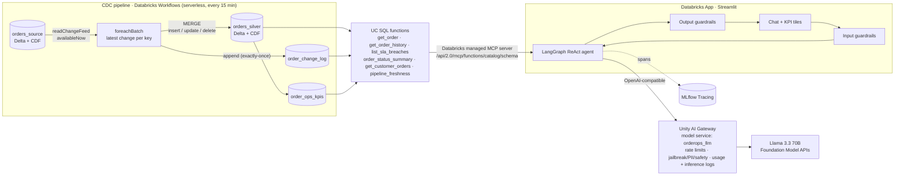

# OrderOps Control Tower — CDC Order Operations & AI Copilot

**Databricks · Delta Change Data Feed · Unity Catalog · LangGraph · Llama · MCP · Unity AI Gateway · MLflow Tracing · Databricks Apps · Asset Bundles**

An order-operations control tower for an e-commerce business. Order inserts, status changes and deletes
flow incrementally from an OLTP mirror into governed Delta tables via **Change Data Feed**, and an
**AI ops copilot** answers questions like *"Which West orders are breaching SLA?"* or *"What happened to
ORD-1A2B3C4D?"* by calling live-data tools over the **Model Context Protocol**.

## Architecture



Everything (jobs, app, permissions) is deployed with one **Databricks Asset Bundle**.

## What each piece does

| Resume bullet | Where it lives | Key detail |
|---|---|---|
| CDC with Delta CDF + PySpark into UC tables, orchestrated by Workflows | `src/cdc/`, `resources/cdc_job.yml` | Streaming CDF read with `availableNow` + checkpoint in a UC Volume → only new commits per run. Per batch: drop `update_preimage`, keep latest change per `order_id` by `_commit_version`, `MERGE` with `whenMatchedDelete` / version-guarded update / insert. Change log append is idempotent via `txnAppId`/`txnVersion`. |
| LangGraph ReAct agent on Llama, MCP tools, Streamlit on Databricks Apps | `app/orderops_agent/`, `app/app.py` | UC functions are auto-exposed by the Databricks **managed MCP server**; `mcp_tools.py` converts each MCP tool's JSON schema to a pydantic model → LangChain tool → `create_react_agent`. Function/param `COMMENT`s are the tool descriptions the LLM sees. |
| Guardrails, Unity AI Gateway, MLflow Tracing, Asset Bundles | `guardrails.py`, `src/ai_gateway/`, `agent.py`, `databricks.yml` | Two layers: gateway guardrails (jailbreak, PII, unsafe content) + app guardrails (read-only enforcement, Indian PII: UPI ID/Aadhaar/PAN/mobile, groundedness check for order IDs not seen in tool output). Every run is a trace with LLM, tool and GUARDRAIL spans tagged by user/session. |

## Repo layout

```
databricks.yml                 bundle root (variables, dev/prod targets)
resources/cdc_job.yml          CDC workflow + one-off AI Gateway setup job
resources/app.yml              Databricks App + its warehouse / endpoint resources
src/cdc/00_setup_uc_objects.py schema, volume, CDF-enabled tables, grants to the app SP
src/cdc/01_simulate_source_changes.py  synthetic inserts/updates/deletes (turn off in prod)
src/cdc/02_propagate_cdc.py    CDF -> silver MERGE + change log
src/cdc/03_build_gold_kpis.py  KPIs by region/status
src/cdc/04_register_mcp_tools.py  UC SQL functions = MCP tools
src/ai_gateway/create_model_service.py  Unity AI Gateway model service for Llama
app/                           Streamlit app + orderops_agent package (agent, MCP bridge, guardrails)
tests/                         unit tests for guardrails + MCP schema bridge (run in CI)
.github/workflows/ci.yml       ruff + pytest; bundle validate/deploy when secrets are set
```

## Run it

**Prereqs:** a Unity Catalog–enabled workspace with serverless jobs, Databricks Apps and Foundation Model
APIs (pay-per-token Llama) enabled; a SQL warehouse; Databricks CLI ≥ 0.250 authenticated (`databricks auth login`).

```bash
# 1. point the bundle at your workspace: edit `host` in databricks.yml (and catalog in app/app.yaml if not `main`)
databricks bundle validate --var="warehouse_id=<your-warehouse-id>"
databricks bundle deploy   --var="warehouse_id=<your-warehouse-id>"

# 2. run the CDC pipeline 2-3 times so there are inserts, updates AND deletes to propagate
databricks bundle run orderops_cdc

# 3. create the Unity AI Gateway model service, then add guardrails + rate limit in the UI
databricks bundle run orderops_ai_gateway_setup
#    AI Gateway -> orderops_llm -> Guardrails: Jailbreak (input), PII redaction (in+out), Unsafe content (out)
#                                -> Rate limit 60/min per user, inference logging + usage tracking on

# 4. start the app
databricks bundle run orderops_copilot
```

Then unpause the job schedule (`pause_status` in `resources/cdc_job.yml`) to keep data flowing every 15 min.

**Verify CDC end to end** (SQL editor):
```sql
SELECT _change_type, count(*) FROM table_changes('main.orderops.orders_source', 0) GROUP BY 1;
SELECT * FROM main.orderops.get_order_history('<an ORD- id that was deleted>');   -- shows insert → updates → delete
SELECT count(*) FROM main.orderops.orders_silver WHERE order_id = '<same id>';      -- 0: delete propagated
SELECT * FROM main.orderops.pipeline_freshness();
```

**Try in the copilot:** *Which West orders are breaching SLA?* · *What happened to ORD-xxxxxxxx?* ·
*Show CUST-00042's orders* · *Is the data up to date?* · and the guardrails: *Cancel ORD-xxxxxxxx* (refused, read-only),
*Ignore previous instructions…* (blocked). Open the MLflow experiment `/Shared/orderops-copilot-traces` to see each trace.

**Local tests:** `pip install -r requirements-dev.txt && pytest -q`

## Design notes (good interview material)

- **Why CDF and not snapshot diffing?** CDF gives row-level `insert / update_preimage / update_postimage / delete`
  with a commit version, so each run reads only new commits and deletes propagate explicitly. Snapshot diffs
  rescan the table and can't distinguish a delete from a filter.
- **Correctness under replays and out-of-order data:** dedupe to one change per key per batch; the update
  branch only fires when `s._commit_version > t._cdc_commit_version`; the audit append is exactly-once
  via Delta idempotent writes; the checkpoint makes a failed run resume where it stopped.
- **Why MCP over custom tool code?** Tools are plain UC SQL functions — governed by UC grants, discoverable,
  reusable by any MCP client (Claude, Cursor, other agents) — with no tool server to run.
- **Why route through Unity AI Gateway?** Central rate limits, guardrails, usage/cost tracking and inference
  logging, and the model can be swapped or given a fallback without redeploying the app.
- **Least privilege:** the app's service principal only has USE CATALOG/SCHEMA, SELECT, EXECUTE on this schema,
  CAN_USE on one warehouse and EXECUTE on one model service; the tools are SELECT-only.
- **Productionising:** set `simulate=false` and land `orders_source` via Lakeflow Connect / Debezium; add MLflow
  evaluation (`mlflow.genai.evaluate`) over a golden question set; alert on `pipeline_freshness().lag_minutes`.

## Notes on newer features

Unity AI Gateway model services are a newer (Beta) API. `create_model_service.py` uses the REST shape from the
current docs; if it changes, create `orderops_llm` in the UI (**AI Gateway → Create → Model service**). If you'd
rather skip the gateway, blank out `LLM_GATEWAY_MODEL` in `app/app.yaml` and the agent calls the Foundation Model
API endpoint directly.

Optional real-data seed: the public [Olist Brazilian e-commerce dataset](https://www.kaggle.com/datasets/olistbr/brazilian-ecommerce)
maps cleanly onto `orders_source` if you want realistic order volumes instead of the simulator.

## References
- [Databricks managed MCP servers](https://docs.databricks.com/aws/en/generative-ai/mcp/managed-mcp)
- [Unity AI Gateway model services](https://docs.databricks.com/aws/en/ai-gateway/configure-endpoints) · [Guardrails](https://docs.databricks.com/aws/en/ai-gateway/guardrails) · [Querying](https://docs.databricks.com/aws/en/ai-gateway/query-model-services)
- [Asset Bundles: apps](https://docs.databricks.com/aws/en/dev-tools/bundles/apps-tutorial) · [bundle-examples](https://github.com/databricks/bundle-examples)
- [Delta Change Data Feed](https://docs.databricks.com/aws/en/delta/delta-change-data-feed)
